## Item Catalog

Every item added by the Sculk Depths Minecraft mod. Previews are generated from
the mod's own models and textures. Hand-written notes are kept for the items
that have them; the remaining entries show a preview image.

### Energy Essence
- Drops when the warden kills a passive mob or when the warden is killed.
- Used to craft an Energized Flint and Steel to open the portal. (pre x.x.x)
- Can be placed on a pedestal to activate the portal. (post x.x.x)

### Energized Flint and Steel (pre x.x.x)
- Can light most blocks with Soul Fire
- lights the portal

### Blue Crystal

### Chomper Colossus Spawn Egg

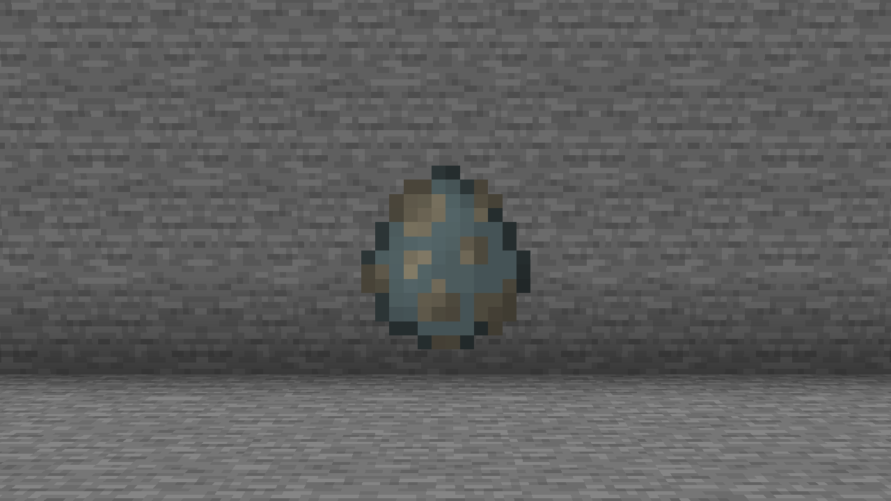

### Coated Valtrox Hanging Sign

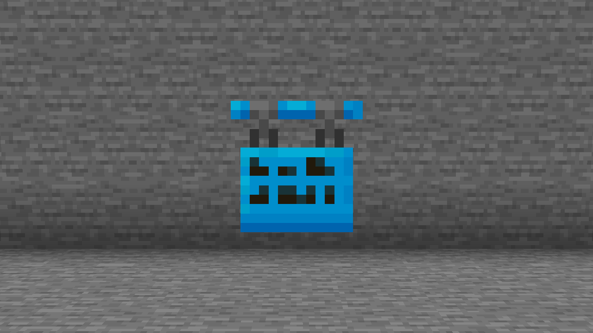

### Coated Valtrox Sign

### Crux

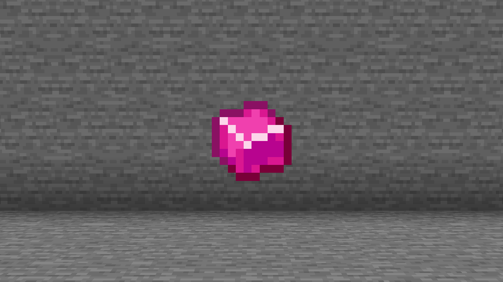

### Crux Resonator

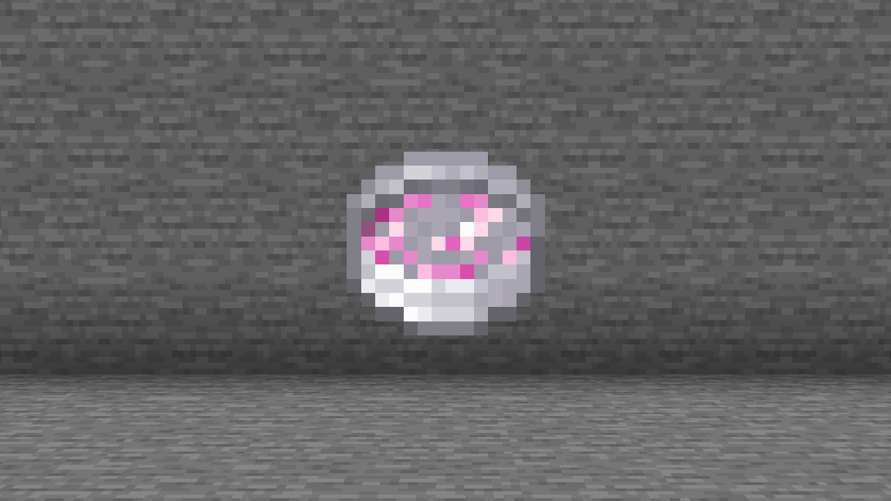

### Dried Valtrox Hanging Sign

### Dried Valtrox Sign

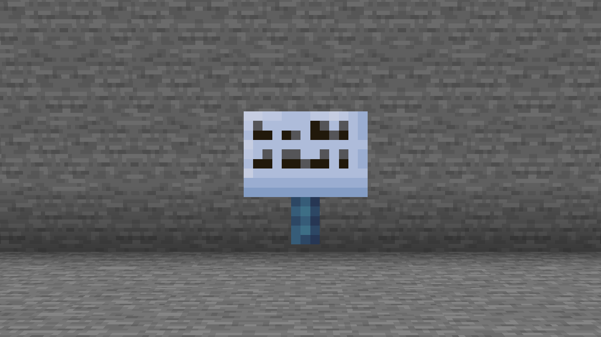

### Glomper Glux

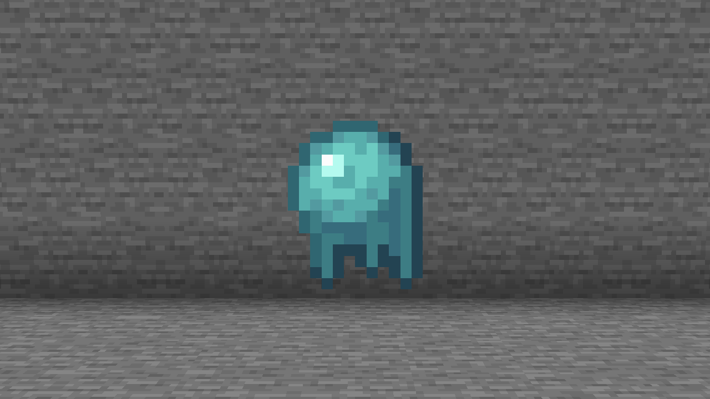

### Glomper Spawn Egg

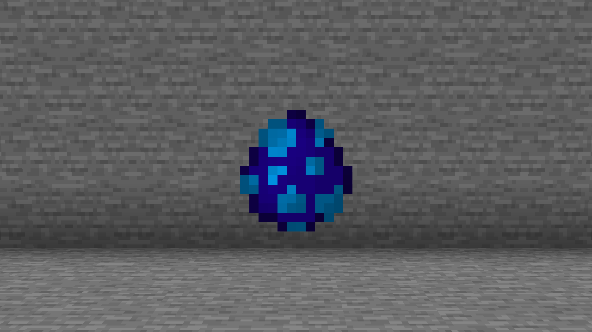

### Kryslum Bucket

### Lester Spawn Egg

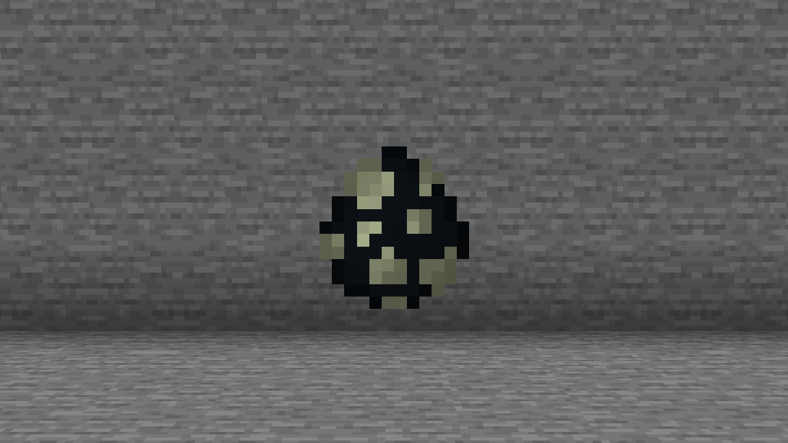

### Lime Crystal

### Music Disc

### Orange Crystal

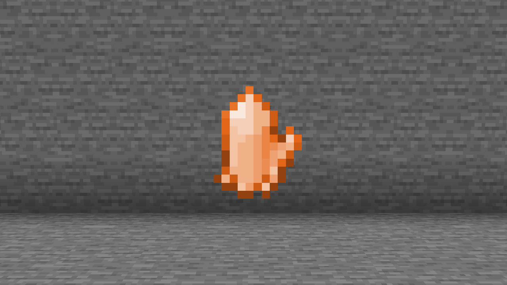

### Penebrium Spore Bucket

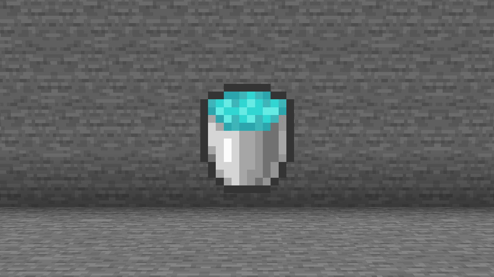

### Petrified Valtrox Hanging Sign

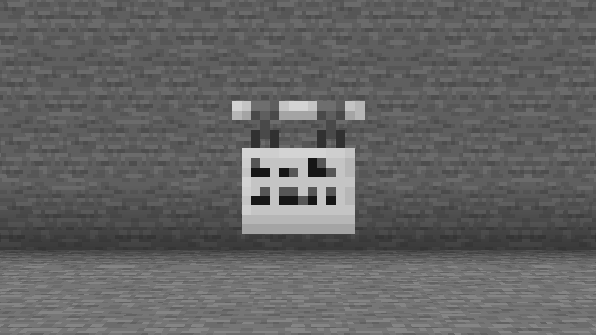

### Petrified Valtrox Sign

### Qelberries

### Quazarith Axe

### Quazarith Boots

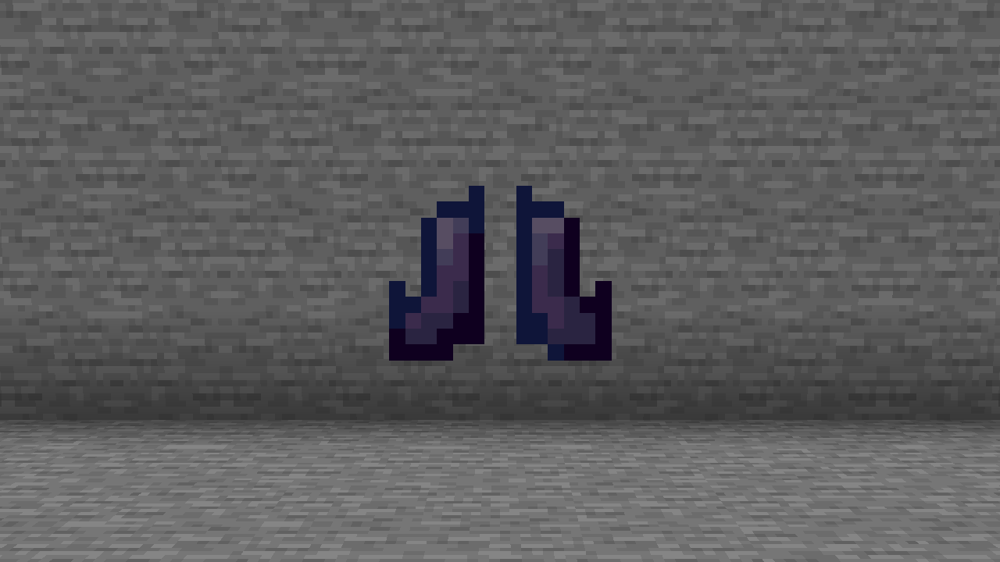

### Quazarith Chestplate

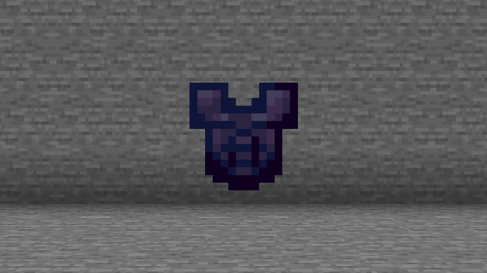

### Quazarith Helmet

### Quazarith Hoe

### Quazarith Ingot

### Quazarith Leggings

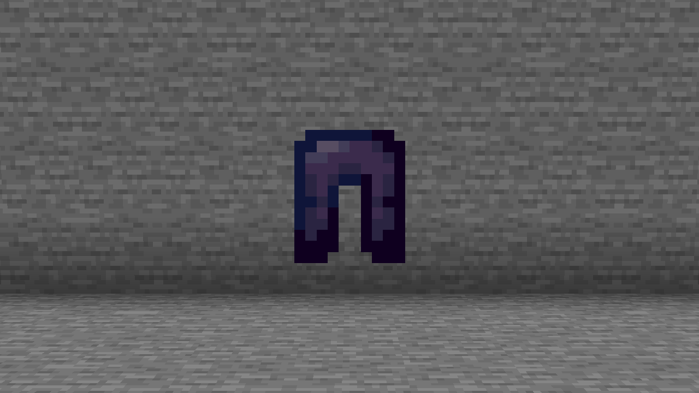

### Quazarith Pickaxe

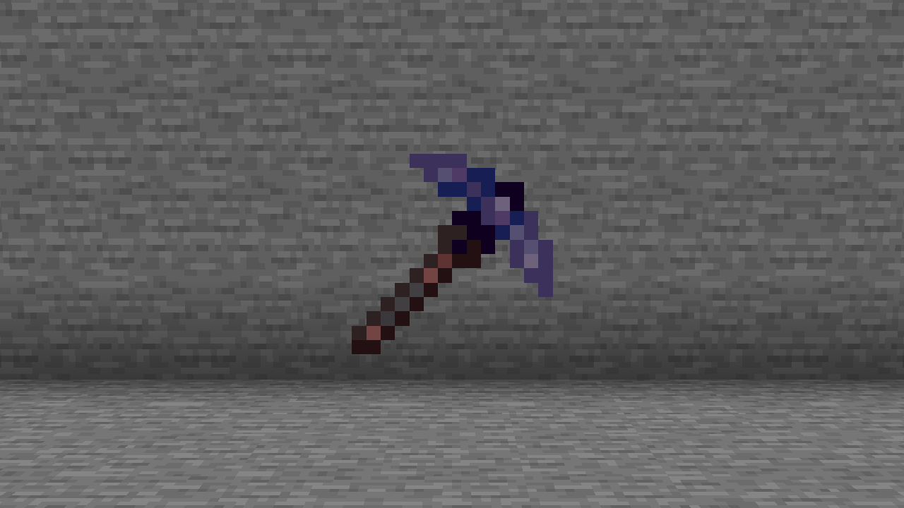

### Quazarith Pieces

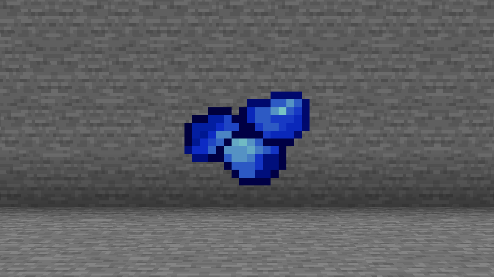

### Quazarith Shovel

### Quazarith Sword

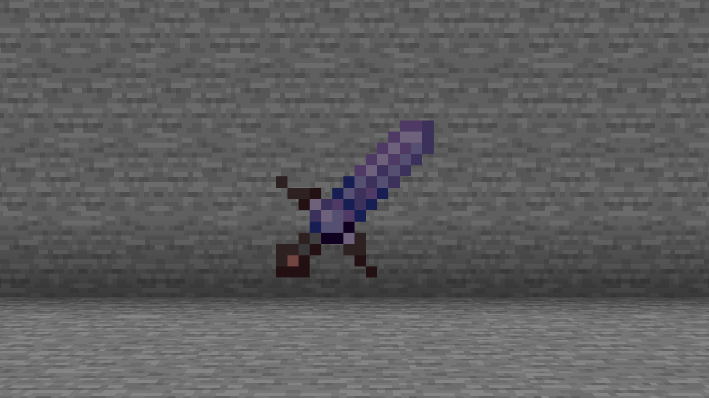

### Valtrox Hanging Sign

### Valtrox Sign

### White Crystal

### ...
